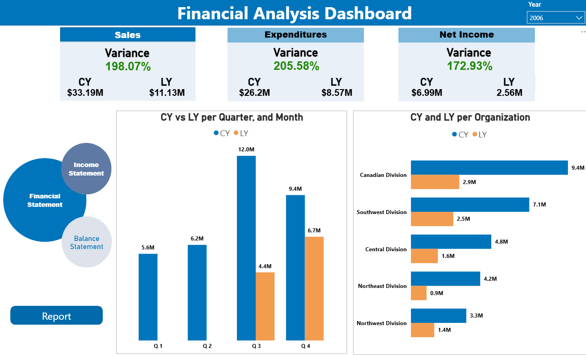
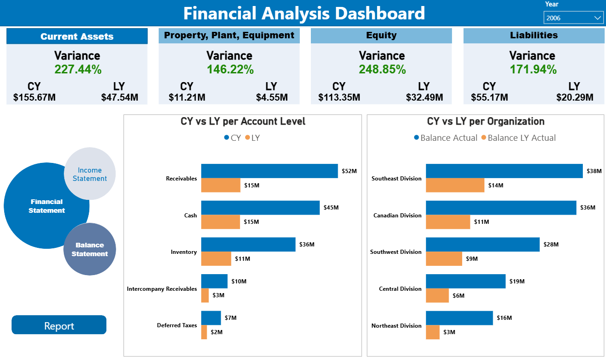
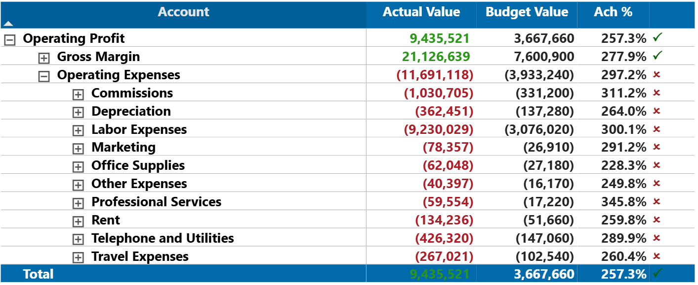
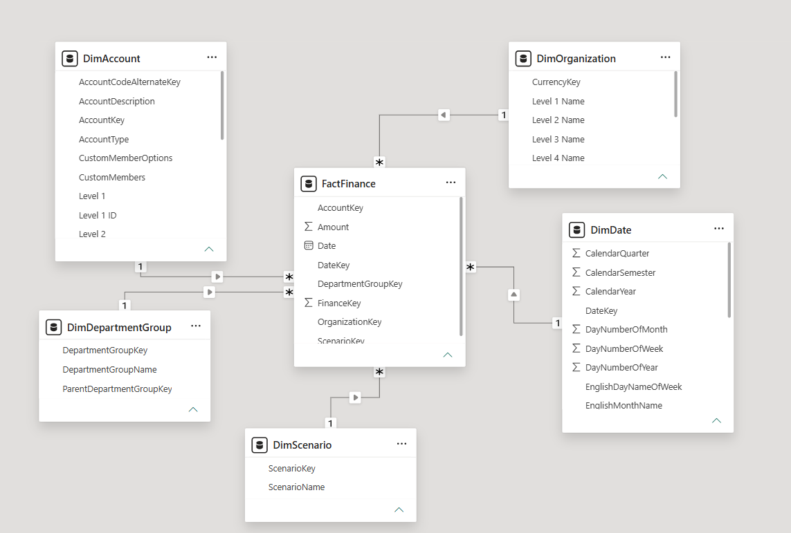

# Finance Performance Dashboard

Power BI financial analysis project focused on **Actual vs. Budget**, **current year vs. last year**, variance analysis, financial statements, and organizational performance.

**Power BI · DAX · Power Query · Excel · Dimensional Modeling**

## Project Overview

The report transforms finance data into an interactive reporting layer for analyzing sales, expenditures, net income, balance sheet accounts, budget achievement, and organizational performance.

## Report Pages

### Income Statement

Executive view of **Sales, Expenditures, and Net Income**, including current-year vs. last-year comparisons, quarterly performance, and organization-level analysis.



### Balance Sheet

Balance sheet analysis covering **Current Assets, Property Plant & Equipment, Equity, and Liabilities**, with account-level and organization-level CY vs. LY comparisons.



### Income Statement Report

Detailed financial statement matrix with expandable account hierarchy, **Actual Value, Budget Value, Achievement %**, and conditional performance indicators.



## Business Questions

The report is designed to answer questions such as:

- How is current financial performance comparing with the previous year?
- How are actual results tracking against budget?
- Which financial categories show the largest variances?
- How are Sales, Expenditures, and Net Income changing across periods?
- Which organizations contribute most to financial performance?
- Which balance sheet accounts are driving the largest changes?
- Which income statement accounts are over or under budget?

## Data Model

The semantic model is centered on `FactFinance` and connected to finance dimensions:

- `DimAccount`
- `DimOrganization`
- `DimDate`
- `DimDepartmentGroup`
- `DimScenario`

The model supports account hierarchies, organization analysis, scenario analysis, and time-based reporting.



## Key Measures

Examples of measures implemented in the Power BI report include:

- Revenue / Sales Actual
- Revenue / Sales LY Actual
- Revenue Variance
- Expenditures Actual
- Expenditures LY Actual
- Expenditures Variance
- Net Income Actual
- Net Income LY Actual
- Net Income Variance
- Balance Actual
- Balance LY Actual
- Balance YOY Variance
- Income Statement Achievement %
- Income Statement Actual Value
- Income Statement Budget Value
- KPI and conditional-formatting indicators

## Report Features

- Executive KPI cards
- Actual vs. Budget analysis
- Current Year vs. Last Year analysis
- Quarterly and monthly financial analysis
- Organization-level comparison
- Account hierarchy drill-down
- Balance sheet reporting
- Income statement reporting
- Achievement percentage calculations
- Conditional KPI indicators
- Interactive year filtering

## Tools & Technologies

- **Power BI Desktop**
- **DAX**
- **Power Query**
- **Microsoft Excel**
- **Dimensional Data Modeling**
- **Financial KPI Analysis**

## Repository Structure

```text
finance-performance-dashboard/
├── README.md
├── dashboard/
│   └── Finance Dashboard.pbix
├── data/
│   └── Finance Dataset.xlsx
├── images/
│   ├── income-statement.png
│   ├── balance-statement.png
│   ├── income-statement-report.png
│   └── data-model.png
└── docs/
    ├── report-structure.md
    └── measures.md
```

## Files

- `dashboard/Finance Dashboard.pbix` — Power BI report
- `data/Finance Dataset.xlsx` — source dataset
- `docs/report-structure.md` — report pages and model overview
- `docs/measures.md` — documented measure inventory

## Author

**Omar Ali**  
Data Engineering · Analytics Engineering

[LinkedIn](https://www.linkedin.com/in/eng-omargomaa) · [GitHub](https://github.com/omaraligomaa)
